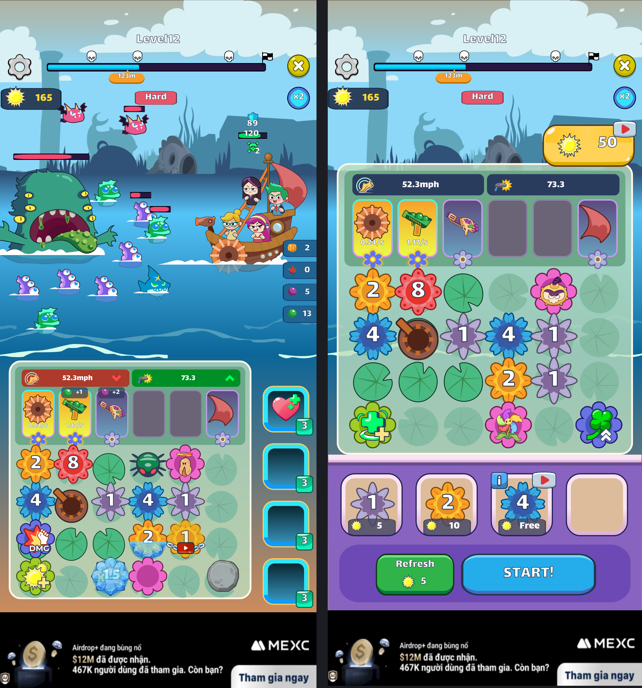

# Gear Combat UI — Bài thực hành 4

Unity **2022.3.62f2**. Mở scene `Assets/CombatUI/CombatUI_Demo.unity`.

Hai trạng thái **xếp gear** và **combat** bám hình Level12 / Hard trong đề: tiền 165, tiến trình 123m, chỉ số 52.3mph và 73.3; các gear, shop và booster có vị trí riêng trong hierarchy.

- Bấm **START!** để chuyển sang combat; **Tab** đổi qua lại hai trạng thái.
- Settings mở cài đặt; nút X trên cùng mở Give Up, Quit quay về xếp gear.
- Phím 1–8 xem các popup có sẵn, phím 0 đóng popup.
- Menu **Combat UI → Match Assignment Reference** hoặc **Rebuild Demo Scene** dựng lại scene.

`AssignmentResponsiveLayout` đặt UI theo chiều cao màn hình trong vùng thiết kế 740 đơn vị, căn giữa trên tablet. `ResponsiveCanvasScaler` giữ đủ chiều ngang trên điện thoại dài. Đã render kiểm tra **1080×2520 (9:21)** và **1536×2048 (3:4)**; ảnh ở `Screenshots/`.

## Ảnh toàn màn theo slide

Combat bên trái, xếp gear bên phải. Hai ảnh giữ nguyên toàn bộ khung hình và tỉ lệ của hình tương ứng trong slide.

[Combat — 1124×2444](Screenshots/slide_battle.png) · [Xếp gear — 1116×2436](Screenshots/slide_buy.png)

| Tỉ lệ | Xếp gear | Combat |
|---|---|---|
| 9:21 | [1080×2520](Screenshots/r921_buy.png) | [1080×2520](Screenshots/r921_battle.png) |
| 3:4 | [1536×2048](Screenshots/r34_buy.png) | [1536×2048](Screenshots/r34_battle.png) |

Menu **Combat UI → Capture Full Screens** chụp lại các ảnh riêng từ scene đã lưu.

Các khung, chữ, nút, gear, tàu, nhân vật và quái là những thành phần Unity riêng. Asset đã tải trực tiếp từ bản Figma có quyền truy cập, giữ SVG gốc và render vector ở 4× cho sprite Unity. Các số trên gear là chữ TMP riêng. Ảnh cắt từ slide/tutorial trước đây đã được thay và xóa khỏi ReferenceSprites.

Nguồn, node ID, kích thước và SHA256 ở Assets/CombatUI/FigmaSprites/sources.json; cách xuất ở SOURCES.md. Riêng banner quảng cáo trong Figma vốn là image fill của ảnh chụp: project giữ toàn bộ BannerSource.png và dùng UV theo đúng fill transform của Figma. Asset raster gốc của băng, đá và đậu cũng được giữ.

Các prefab snapshot Stage5 và popup cũ được giữ lại để tiếp tục chỉnh sửa. Bài này minh họa UI, chưa triển khai gameplay, mua gear hay quảng cáo thật.
